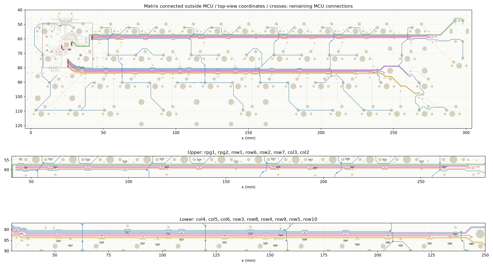

# ROW分割後の配線

追記: この作業後に[C14・R3を移設](../mcu-layout/c14/README.md)しました。以下の部品配置比較・検証記録はROW分割時点のものです。マトリクスの配線と未接続19件は維持しています。

2026-10-30。基板本体 `../ts52k.kicad_pcb` のマトリクスを6列×10行へ更新しました。横幹線と全53組のスイッチ―ダイオード接続は完成し、未接続はMCU近傍の19件だけです。幹線の途中に未接続はありません。

既存の横幹線の上下順を維持し、各ROWの隣に追加ROWを挿入しました。引き直した幹線の幅は0.20 mmです。ダイオード付近では束の間隔を局所的に広げ、連続した配線でパッドを避けています。変更した幹線とスイッチ―ダイオード接続は裏面で、新しいビアは追加していません。

今後の手配線の既定値は線幅0.15 mm、クリアランス0.20 mmです。Defaultネットクラスを設定し、開始トラックの幅の自動引き継ぎを解除しました。ROW/COLのトラック・ビアにはMCU内でも0.20 mmのクリアランスを適用します。既存MCUパッド周辺・他のMCU配線の0.15 mm例外と、Tag-Connectの0.508 mmルールは維持しています。JLCPCBの2層・1 ozでは線幅0.15 mm／間隔0.20 mmは[公表製造能力](https://jlcpcb.com/capabilities/pcb-capabilities/)の範囲内です。

| 場所 | 上から下への幹線の順序 |
| --- | --- |
| 上側 | rpg1 → rpg2 → row1 → row6 → row2 → row7 → col3 → col2 |
| 下側 | col4 → col5 → col6 → row3 → row8 → row4 → row9 → row5 → row10 |

ダイオード50個を変更しました。横移動はD48の左0.35 mmだけです。上下移動は最大2.007 mm（D8）、他は最大1.210 mmで、回転は必要な部品の180度反転だけです。ダイオード以外の94部品は位置・角度・面を保持しています。電源・USB・クロック・QSPI・その他の447銅箔要素も変更前と一致しています。

MCU側の配線端は、上側がx=42.029 mm、下側がx=25.5 mmのMCU付近へ集めています。残る未接続はU5への接続と、MCU脇のD2/D3およびCOL1の接続です。検証領域は制御回路のあるx=8〜42.6 mm、y=49〜80 mmとし、すべての未接続端がこの中にあることを確認しました。

最終チェックは元のプロジェクト設定で `kicad-cli pcb drc --schematic-parity --refill-zones --save-board` を実行しました。別の接続検査でも、領域外の各ROW/COLのパッドが同じネットの共通部分につながることと、全53組のスイッチ―ダイオード間の導通を確認しています。

| チェック | 結果 |
| --- | ---: |
| MCU近傍以外の未接続 | 0 |
| MCU近傍の未接続 | 19 |
| DRCエラー | 0 |
| 回路図との不一致 | 0 |
| 警告 | 146 |

警告はライブラリ形状差91件、シルク関連35件、配線端17件、ビアの片面接続3件です。移動後のダイオードのコートヤードと表側部品の貫通ピン・位置決め穴に0.25 mm未満の接近はありません。包括監査では表裏の投影外接矩形・シルク等54件が報告されています。製造用データは更新していません。

[検証サマリー](validation.json)と[配線プレビュー](preview.png)を保存しています。配置・配線・検証に用いた補助スクリプトはローカルに残しています。以降、手配線用の `.kicad_pro` / `.kicad_dru` 設定は上記の値へ更新しています。
