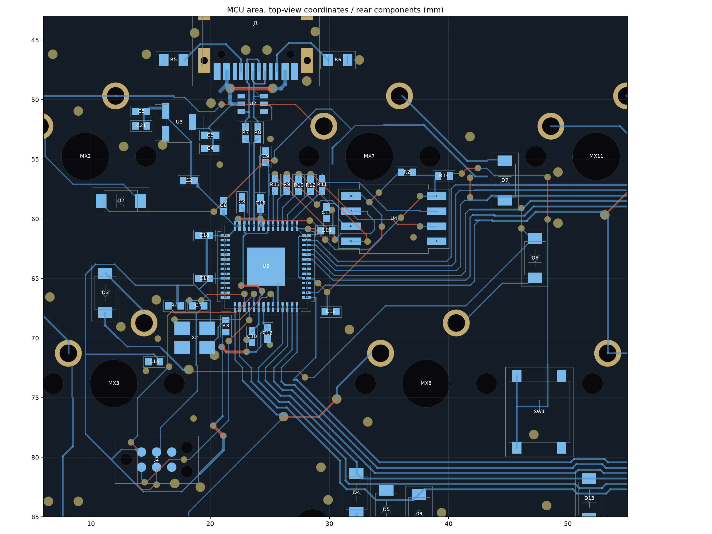
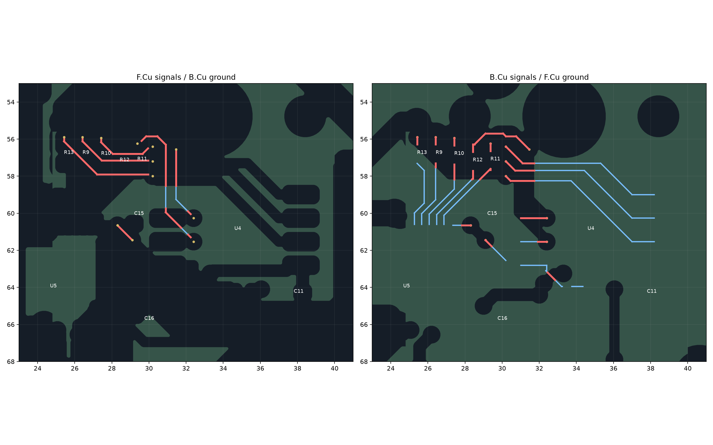

# MCU・Flash周辺の配置と配線

2026-10-30追記: [X2のパスコンC14を移設](c14/README.md)し、電源ピンまでの経路を約27.69 mmから1.60 mmへ短縮しました。R3も移動しています。以下の配置と検証値は、それ以前の作業記録です。

2026-10-30。`3f8d45b` から1V1系パスコンの配置を詰め、[基板本体](../ts52k.kicad_pcb)へ反映しました。

## 1V1系パスコン

前回はC9からU5の50番ピンへの配線が約5.41 mm残っていました。R13・R9・R10を北へ0.35 mm移し、MCU側のQSPI引き出しを調整して、C9をC13の隣へ移設しました。R11・R12は従来位置です。C8とC10も寄せています。

| 接続 | 変更前 | 変更後 |
| --- | ---: | ---: |
| C8–U5.45 | 1.61 mm | **1.46 mm** |
| C9–U5.50 | 5.41 mm | **1.58 mm** |
| C10–U5.23 | 2.25 mm | **1.76 mm** |

いずれもパッド中心間の電源配線長で、裏面直結・途中ビアなしです。C8/C9には近傍のGNDビアを追加し、C10は既存のGNDビアへ接続しました。GND側の配線長はそれぞれ約0.47 / 1.01 / 0.76 mmです。電源とGNDを合わせたループのインダクタンスや実機波形は測定していません。

C10の場所を空けるため、SWDIOのビアも少し移しました。USB配線、発振器の配線、キーマトリックスは変更していません。容量・部品型番も変更していません。電源ピンへの近接配置の根拠は[Raspberry Pi公式設計資料の2.1.2・2.1.3節](https://datasheets.raspberrypi.com/rp2040/hardware-design-with-rp2040.pdf)です。

| 今回動かした部品 | 中心座標 mm | 角度 |
| --- | --- | ---: |
| C8 | 22.65, 58.75 | 90° |
| C9 | 25.13, 58.65 | 90° |
| C10 | 23.74, 69.50 | −90° |
| R13 | 25.4196, 56.80 | −90° |
| R9 | 26.4196, 56.80 | −90° |
| R10 | 27.4196, 56.85 | −90° |

他の141部品は位置・角度・面を維持しています。前回短縮したC11–U4.8の**1.52 mm**、C16–U5.10の**1.51 mm**を含め、測定対象の3V3系7接続の長さは変わっていません。

## QSPIと対向GND

Flash側の長い裏面3本は変更していません。CLK・SD0・SD3のX ≥ 31.8 mmの区間、計**22.29 mm**について、再充填した対向面GNDが中心線と幅0.35 mmの帯を連続して覆うことを確認しました。

MCU側の引き出しや層変更部には局所的なGNDの抜けが残っています。全QSPI中心線の対向GNDがない部分の合計は、今回の変更で **36.08 → 38.14 mm** になりました。ビアのアンチパッドや端子周辺も含む幾何学的な測定です。1V1パスコンを優先した結果、抵抗付近の配線と局所的な抜けは少し増えています。全経路の連続GNDを保証するものではありません。

| 信号 | 変更前 | 変更後 |
| --- | ---: | ---: |
| CLK | 16.54 mm | 17.44 mm |
| SD0 | 15.50 mm | 16.41 mm |
| SD1 | 12.91 mm | 13.01 mm |
| SD2 | 12.89 mm | 12.89 mm |
| SD3 | 17.79 mm | 19.02 mm |

上表はMCU側・Flash側ネットのトラック中心線長の合計です。抵抗本体とビアの縦方向の長さは含みません。

## 制約と検証

- 全表面部品、USBコネクタ、U2、R7/R8、U5、Flash、発振器、Tag-Connect、BOOTSELの配置を維持。
- USBの29銅箔要素を座標・幅・層とも維持。R7/R8からU5までD−/D＋とも **7.435 mm**、裏面のみ・ビアなし。
- 当初のマトリックス／エンコーダ主幹603要素を維持。MCUから既存末端への13信号は裏面接続のまま。
- 変更線分はすべて縦・横・45°。
- 移動部品のコートヤードと表面部品の貫通部・位置決め穴を照合。今回の移動部品の最小隙間はR10の約**0.334 mm**。部品同士のコートヤードはネイティブDRCでも確認。ケースを含む3D干渉確認ではありません。
- 表面トラック長 **170.82 → 172.49 mm**、裏面 **4455.08 → 4454.61 mm**。全配線長の裏面比率は **96.27%**。

| 項目 | 結果 |
| --- | ---: |
| DRCエラー | **0** |
| 未接続 | **0** |
| 回路図との不一致 | **0** |
| DRC警告 | 133 |
| ERCエラー／警告 | 0／1 |

DRC警告はライブラリ形状差91、シルクと銅箔24、シルク同士11、シルクと外形3、既存の枝端3、X2-ENの片面接続ビア1です。ERC警告はU3のライブラリシンボル差です。設計ルールの緩和・DRC除外の追加はありません。

MCPのDRCと包括監査も実行しました。包括監査は57件（外接矩形の重なり34、禁止領域／外形2、シルクとパッド18、シルク文字同士3）です。表裏の投影矩形、USBの意図した張り出し、Tag-Connect自身の禁止領域を含むため、実際のコートヤードDRCと貫通部との幾何検査を併用しています。既存のシルク問題も残っています。

- [測定値と保持対象](validation.json)
- [最終DRC](final-drc.json) / [変更前DRC](before-drc.json) / [ERC](erc.json)
- [JLCPCB向け出力と再生成手順](../jlcpcb/README.md)

ガーバー、ドリル、BOM、実装座標を更新済みです。角度の出力・補正処理は変更していません。作業候補と検証スクリプトはローカルの `revision4/` に残しています。
