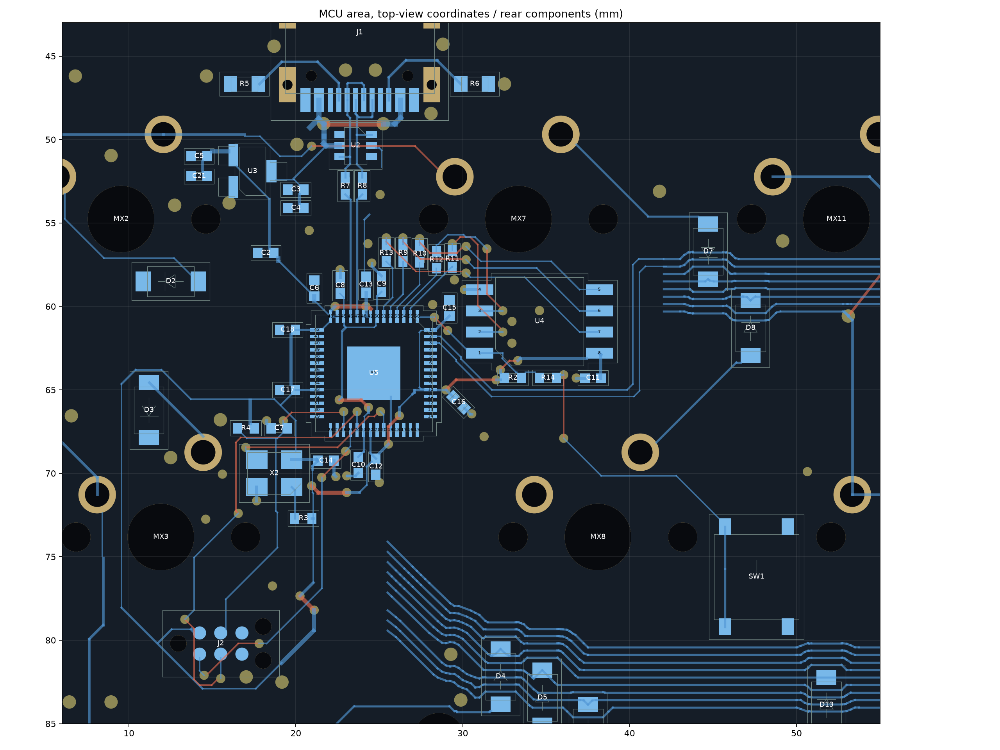

# X2のパスコンC14の移設

2026-10-30。C14をX2の電源ピンの右隣へ移し、R3をX2の下側へ移しました。基板本体へ反映済みです。

| 項目 | 変更前 | 変更後 |
| --- | ---: | ---: |
| C14.1 → X2.4の電源経路 | 約27.69 mm | **1.60 mm** |
| C14の位置・角度 | (15.3, 72.0) mm、180° | (21.8, 69.25) mm、0° |
| R3の位置・角度 | (21.3, 69.0) mm、90° | (20.45, 72.7) mm、180° |

電源経路はパッド・トラック中心をたどった長さで、ビアの縦方向の長さを除きます。変更後は裏面直結で電源側の途中ビアはありません。C14のGND側は約1.00 mm、X2のGND側は0.825 mmの配線で、それぞれ近接GNDビアへ接続しました。

C14・R3以外の145部品と、既存銅箔2671要素は変更していません。旧C14の電源枝2本とX2-ENの4要素を除去し、局所的な電源・GND・EN配線を引き直しました。ROW/COL、USB、QSPI、クロック出力の配線は維持しています。

DRCエラー0件、回路図との不一致0件。未接続は従来どおりMCU近傍の19件です。移動部品と表側の貫通ピン・位置決め穴にも干渉はありません。

[変更と経路長の検証記録](validation.json)。以前のMCU・マトリクス配置の検証記録は、それぞれの作業時点のものです。
