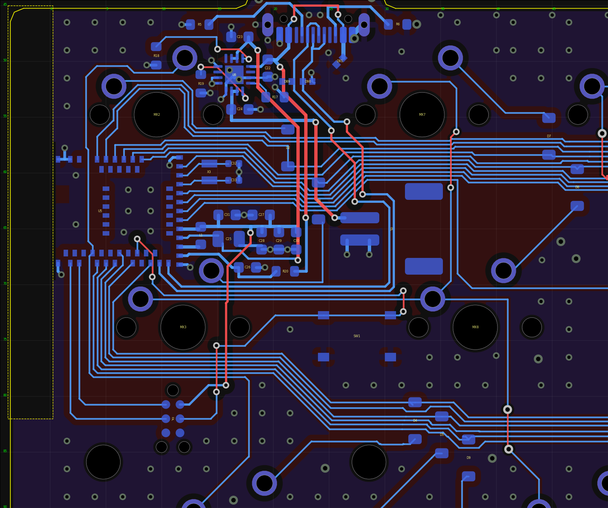
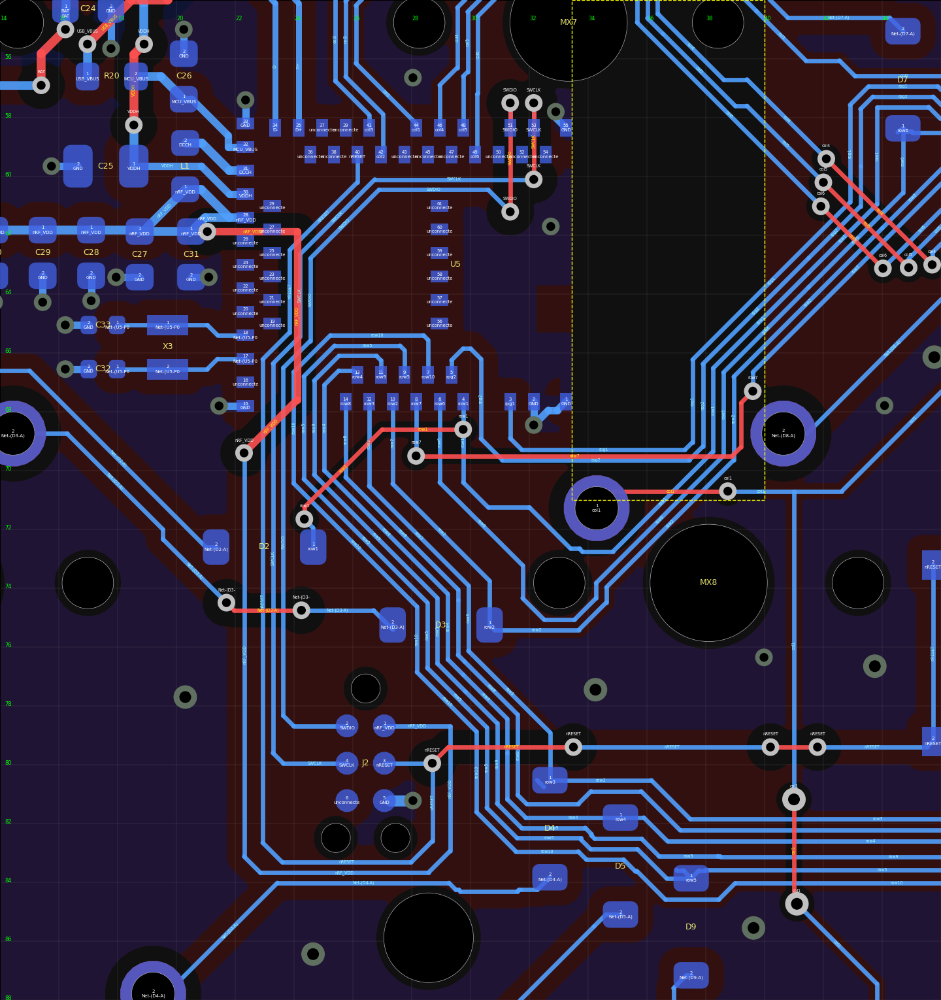
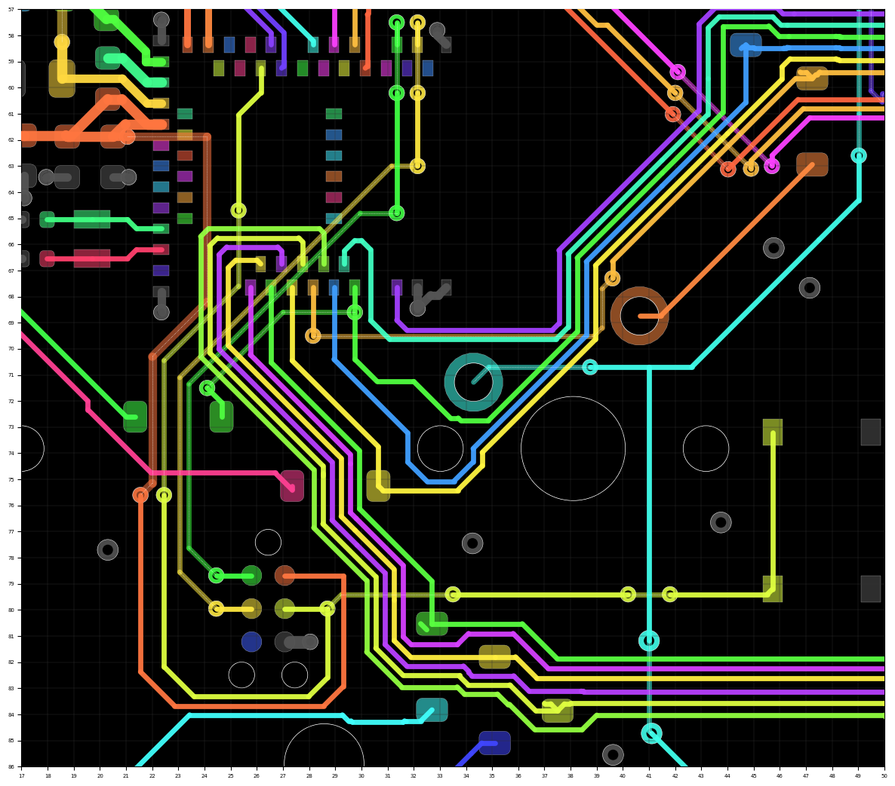
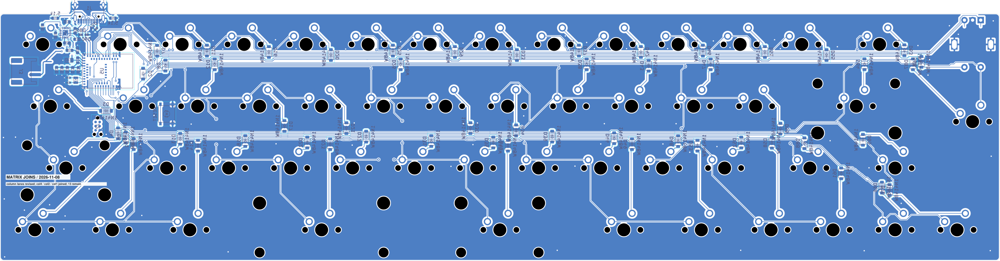

# 無線版PCB：マトリクス横バスの仮配線

## 2026-11-10：モジュールを基板左端へ移設（最新、ブランチ claude-fable-antenna-2026-11-10）

コミット `891e14f` を起点に、U5（MDBT50Q）を基板の内側から左端へ移し、アンテナを基板端・外向きにした。あわせてGPIO割当て（回路図）と西側の配置・配線を作り直した。実機検証・製造データは未着手で、完成という意味ではない。

[モジュール周辺の拡大](antenna-module-2026-11-10.png) / [確認記録](antenna-check.json) / [現在のDRC](drc.json) / [作業スクリプト](scripts-2026-11-10-antenna/README.md)

画像は `scripts-2026-11-10-review/render_region.py` がpcbnewのデータから描いた確認用の図で、KiCadの画面そのものではない。赤がF.Cu、青がB.Cu、黄の破線がルールエリア。

### 配置

| 部品 | 起点 | 現在 |
| --- | --- | --- |
| U5 モジュール | (29.5, 63.0) 90°、アンテナは東（MX8側） | (4.45, 63.4) 270°、アンテナは西（基板左端） |
| J3 電池コネクタ | (4.42, 63.09) 90° | (30.6, 65.0) 270°、挿入口は東 |
| X3・C32・C33 水晶 | モジュール西 | モジュール東 (14.25, 59.9)、(16.45, 59.15／60.65) |
| L1・C25〜C31 電源コンデンサ | モジュール西 | モジュール東 x=13.5〜22.1、y=63.3〜68.9 |
| R20（2.2 Ω） | (17.8, 56.6) | (21.075, 68.8)、C26の隣 |
| D2（MX2） | (23.0, 72.6) | (21.3, 57.75) |
| D3（MX3） | (29.0, 75.25) | (24.05, 62.5) |
| J2 Tag-Connect | (26.435, 79.95) | (11.0, 82.0) |
| SW1 リセット | (47.6, 76.2) 90° | (27.5, 74.6) 0° |

J1・U6とその周辺（C22〜C24、R5、R6、R17〜R19、D89〜D91）、MX、ほかのダイオードは動かしていない。

- モジュール本体の左端は基板端から0.27 mm内側。U5のy位置は、北のMX2中央穴（本体まで1.38 mm）と南のMX3端子パッド（1.50 mm）の間で決めた。
- アンテナ禁止領域（x=−3.3〜0.5、y=57.2〜69.6）に加え、基板左端から3.8 mm（x<0.23）をy=45.0〜82.0の範囲で表裏とも銅箔なしにするルールエリア `ANT_EDGE` を置いた。メーカー図の「No Ground-Pad Area」を基板端に沿って延ばした形で、長さは約36.7 mm。配線・ビア・ベタは入っていない。
- モジュール四隅のGNDパッド（1・2、15、33、55）の近くにGNDビアを置き、本体の下にもGNDビアを8個置いた。

### 配線

- **マトリクス18本**は、モジュールの外周順とバスの並び順を揃えて割り当て直し（[割当て表](../../notes/wireless-pin-assignment.md)）、モジュールからバスまでB.Cuだけで届く。
  - 上段入力のうちrow1・row6・row2・row7は北側パッドからMX2中央穴の下を東へ出る。rpg1・rpg2はMX2中央穴の北を回る。穴とパッド15の間は4本しか通らないため。
  - col6〜col2は東側パッドから水晶の南北を通る。行・列11本の束はD2・D3の端子間を通り、J3の北（y=57.09〜60.59）を東へ進んで既存バスへつながる。
  - col3は北辺の長い配線（約77 mm）をやめ、上段バスの南端（y=61.5）を新しく通した。col2はMX12.1へ南西から入る。どちらも既存の東側ホップはそのまま使う。
  - 下段の行6本とcol1は南側パッドからMX3の西・南を回って下段バスへ入る。col1はモジュール下を通ってMX2.2へも届く。
  - 起点にあったcol4・col5・col6の入力またぎ（F.Cu 3か所）、col1の北回りとx=49のホップ、row7・row1のF.Cu、SWDIO・SWCLKのF.Cuは不要になった。
- **F.Cuで束をまたぐもの**（表は実測）。USBコネクタは北辺、モジュールの電源・USBパッドは南東にあり、その間を上の束が通るため、次の線はF.Cuで越える。

| ネット | F.Cu mm | 内容 |
| --- | ---: | --- |
| D+／D− | 7.08／7.22 | J1の南で束を越える。B.Cuは46.0／44.6 mm（J3の本体下、MX3端子の南を通ってパッド35・34へ） |
| USB_VBUS | 20.40 | J1周りの既存分を含む。R20をモジュール側へ移したので、越えるのはUSB_VBUS |
| VDDH | 20.29 | U6東の既存F.Cuを延長し、C25の手前まで |
| BAT | 9.25 | C24からJ3の1番へ |
| nRESET | 9.97 | モジュール下のビア→本体外（4.0 mm）と、SW1からJ2へ（下段の行をまたぐ） |
| nRF_VDD（VTref） | 14.56 | VDDコンデンサ列からJ2の手前まで |
| col1 | 8.80 | MX8.1からMX7.1へ（5.5 mm）と、下段バスをまたぐ既存ホップ |

### 検査（2026-11-10、KiCad 10.0.8、`--refill-zones` 後）

| 項目 | 起点 `891e14f` | 現在 |
| --- | ---: | ---: |
| 未接続 | 0 | 0 |
| DRC違反 | 9 | 9 |
| 回路図との不一致 | 0 | 0 |
| ERC | 0 | 0 |
| F.Cu配線長 mm | 174.87 | 176.15 |
| うちマトリクス | 117.07 | 78.89 |
| 信号ビア | 63 | 50 |
| うちマトリクス | 37 | 26 |
| うちモジュール本体の下 | 2 | 1 |
| GNDビア | 180 | 247 |
| ビア1個だけのB.Cu GND島（5 mm²以上） | 1 | 0 |

- 残る9件は起点と同じく、D89とD90の外形線の重なり7、J1のシルクと基板端2。
- 短絡、クリアランス、穴間隔、courtyard、keepout、Tag-Connectの0.508 mmルールの違反はない。
- DCCHとLF水晶2本は、B.Cu配線中心と左右0.25 mmのF.Cu GND欠損0。USB D+／D−は欠損あり（2,796点中246、2,709点中370）。場所はF.Cuで束を越える区間、MX3.2のパッド直下を通る約2.8 mm、パッド近くのビア周り。起点は欠損0だった。
- `pcb/check_schematic.py` のGPIO表を新しい割当てに改めて実行し、PASS（マトリクスの接続は旧図と一致）。

以下は各作業時点の記録で、現在の状態ではない。

## 2026-11-10：自己レビューと手直し（ブランチ claude-fable-review-2026-11-10）

コミット `85376c9`（未接続0にした状態）を起点に、基板全体を見直した。回路図・GPIO割当て・部品位置は変更していない。実機検証・製造データは未着手で、完成という意味ではない。

画像は `scripts-2026-11-10-review/render_region.py` がpcbnewのデータから描いた確認用の図で、KiCadの画面そのものではない。赤がF.Cu、青がB.Cu。

[確認記録](review-check.json) / [現在のDRC](drc.json) / [編集・検査スクリプト](scripts-2026-11-10-review/README.md)

### SWD・nRESET・VTrefの引き直し

前回はSWD系4本をモジュール下からF.Cuで南西へ斜めに出し、F.Cu GNDに長さ約27 mmの切れ目を作っていた。これを次の形に改めた。

- モジュール南西角には、パッド15・16（東端x=22.65）とパッド14（西端x=25.55）の間に幅2.9 mmのB.Cuの出口がある。0.15 mm線・0.2 mm間隔で7本まで通る。ここを行のUターン4本（row10・5・9・4）が使っていたので、4本を東へ0.13 mm寄せ、西側にnRESET・SWCLK・SWDIOの3本を並べた。
- SWDIO・SWCLKはパッド51・53の北のビアからF.Cuでパッド列を越え（3.70／2.60 mm）、モジュール内側のビアでB.Cuへ戻る。そこからJ2まで全てB.Cu。
- nRESETはパッド40からJ2.3まで全てB.Cu。SW1への枝（F.Cu 6.63 mm）は従来どおり。
- VTref（nRF_VDD）は8本目が角を通らないため、F.Cuでモジュール内側を南下し、角の外 (22.3, 69.4) のビアでB.Cuへ戻す。F.Cuは17.83→11.32 mm。
- 4本はD2の端子間（x=22.3〜23.63）を通る。D2の位置は不変。row1のD2側ビアは (24.35, 71.65) へ移した。
- D3アノードはこの束をF.Cu 2.66 mm・ビア2個で越える。
- U5.15のGNDビアは (21.45, 67.8) へ移した。

J2の位置・向きは変えていない。

### GND

- B.Cu GNDのうち、表面との接続がビア1個だけで面積5 mm²以上の島が9か所あった。それぞれに2個目のGNDビアを追加した。
- アンテナの先端側と側方（x=33.45〜40.0、y=54.0〜71.0）でGNDベタだけを抜くルールエリア `ANT_NO_FILL` を追加した。配線・ビア・パッドは許可。範囲内で孤立するGNDビア2個は除去した。メーカー指針の「禁止領域を可能な範囲で広げる」への対応で、効果は実測していない。ルールエリアを削除して再充填すれば元に戻る。
- 外径0.5 mm・穴0.3 mmのGNDビア5個（うち2個は上記で除去）を外径0.6 mmへ広げた。

### その他

- 同一直線上で重なっていた線分13組をまとめた。その結果、重複に隠れていたBATの行き止まり1.8 mm（y=60.075）がDRCに現れたので除去した。
- B面の参照名シルクを整理した。0.65 mm高の25個と、パッド・他シルクに重なっていたものを0.8 mm高・0.12 mm太さで置き直し、置き場のない13個（C23 C24 C27 C28 C29 C31 C33 D89 L1 R17 R19 R20 U6）は非表示にした。
- Powerネットクラスの対象が旧RP2040版のネット名（+5V・VCC・+3V3・1V1）のままだったので、USB_VBUS・MCU_VBUS・BAT・VDDH・nRF_VDD・DCCHへ改めた。クリアランスは既定と同じ0.2 mmで、DRCの判定は変わらない。

### 検査（2026-11-10、KiCad 10.0.8、再充填後）

| 項目 | 起点 `85376c9` | 現在 |
| --- | ---: | ---: |
| 未接続 | 0 | 0 |
| DRC違反 | 75 | 9 |
| 回路図との不一致 | 0 | 0 |
| ERC | 0 | 0 |
| F.Cu配線長 mm | 230.17 | 174.87 |
| うちSWDIO・SWCLK・nRESET・nRF_VDD | 82.26 | 24.25 |
| 信号ビア | 67 | 63 |
| うちモジュール本体の下 | 5 | 2 |
| GNDビア | 173 | 180 |
| B.Cu GNDのポリゴン数 | 30 | 28 |

- 起点の値も今回同じ環境で測り直した。前回記録の76件との差1件は、KiCadのグローバルライブラリ表が未設定だったことによるSW2の警告で、基板の違いではない。
- 残る9件はD89とD90の外形線同士の重なり7、J1のシルクと基板端2。
- D+・D−・DCCH・LF水晶2本のB.Cu配線中心と左右0.25 mmを0.05 mm刻みでF.Cu GNDへ投影し、欠損0。
- 短絡、クリアランス、穴間隔、courtyard、keepout、Tag-Connectの0.508 mmルールの違反はない。

以下は各作業時点の記録で、現在の状態ではない。

## 2026-11-10：南側入力・MX2・SWDの接続（ブランチ claude-fable-advance-2026-11-10）

コミット `5ea75d5`（col2・col3を北辺へ移した後）を起点に、残っていた未接続13件を全て接続した。回路図・GPIO割当ては変更していない。移設した部品はD2のみ。実機検証・製造データは未着手で、完成という意味ではない。

[MX2・西端](mx2-west-2026-11-10.png) / [確認記録](south-exit-swd-check.json) / [編集スクリプト](scripts-2026-11-10/README.md)

### MCU南側から上段バスへの6入力

アンテナkeepout（x=33.45〜37.25、y=56.8〜69.2）とMX8の端子・穴の間は、B.Cuで通せる本数が限られる。keepout下端とMX8.1の間が2本、MX8.1と左穴の間が1本、MX8.1と中央穴の間が3本。この通路に合わせて次のように分けた。

| ネット | 経路 |
| --- | --- |
| rpg1、rpg2 | keepout下端沿いの2レーン（y=69.285、69.635） |
| row1 | MX8.1と左穴の間（従来の経路。col1をまたぐF.Cuとビア2個は廃止） |
| row6、row2 | MX8左穴の南を回り、左穴と中央穴の間を北上。row2は途中でD3.1に接続 |
| row7 | U5.8直下のビアからF.Cu 13.24 mmでkeepout下を東へ抜け、MX8.2の北でB.Cuへ戻る |

6本はkeepout東辺とMX8.2の間（x=37.55〜38.95のB.Cu 5本＋row7）を北上し、45°の束で既存のバス西端へつなぐ。rpg1の縦線はx=42.908へ移した。

### 列

- col4・col5・col6：MX7中央穴を回る経路は維持。入力6本の束をまたぐF.Cuホップを並べ直した（各ビア2個、F.Cu 2.98／4.10／5.09 mm）。ホップ後はD8.1の下を通って既存の横バスへ入る。D8アノードはその南へ逃がした。
- col1：MCU→MX7.1→北回り→x=49のF.Cuホップ→MX8方面、の骨格は維持。MX8.1西側の引き出しと不要だったビア2個を除き、x=41の直線で下段バスの既存ホップへつないだ。MX8.1へは東からF.Cu 4.5 mmで入る。MX2.2はR18の端子間→基板西端→J3の端子列とMP端子の間（x=4.0）→MX3.1の順にB.Cuでつないだ。

### MX2とD2

D2はMX2のダイオードだが、アノードがUSB・電源部を横切れず未接続だった。D2を行の壁の西側 (23.0, 72.6)、180°へ移し、アノードはMX2.1→J3の通路（x=4.6）→MX3.2の北→D2.2とB.Cuで接続。row1はU5.4直下のビアからF.Cu 6.85 mmで壁を越えてD2.1へ入る。

### SWD・リセット・VTref（上の見直しで引き直し済み）

SWDIO・SWCLK・nRESET・nRF_VDD（VTref）は、モジュール下のビアからF.Cuで南西へ引き出し、行の壁とD2／D3アノードを越えてからB.Cuへ戻す。SWDIO・SWCLKはJ2西列へ直接、nRESETとVTrefはJ2の穴の南を回って東列へ入る。そのためD4アノードの水平部を0.07 mm南（y=84.02）へ寄せた。nRESET→SW1は行の壁とcol1をF.Cuで2回越える。J2付近のGNDビア2個は位置を移した。Tag-Connectの0.508 mmルールの違反はない。

この引き出しでF.Cuが大きく増えている。SWCLK 24.59、SWDIO 21.13、nRESET 18.71、nRF_VDD 17.83 mm。モジュール直下のF.Cu GNDを4本が斜めに横切る。低速信号だが、J2の位置や向きを見直せば短縮できる可能性がある。今回は位置を維持した。

### 検査（2026-11-10、KiCad 10.0.8、再充填後）

| 項目 | 開始時 `5ea75d5` | 現在 |
| --- | ---: | ---: |
| 未接続 | 13 | 0 |
| DRC違反 | 93 | 76 |
| うち配線・ビア末端 | 17 | 0 |
| 回路図との不一致 | 0 | 0 |
| F.Cu配線長 mm | 149.80 | 230.18 |
| 信号ビア | 63 | 67 |
| GNDビア | 173 | 173 |

- 残る76件はシルクと銅箔の重なり26、文字高さ25、シルク重なり21、シルクと基板端3、ライブラリとの差異1。件数は開始時と同じ。
- 短絡、クリアランス、穴間隔、courtyard、keepoutの違反はない。
- U5.2とJ2.5のGNDパッドは、近くを通した配線でサーマルのスポークが不足したため、ベタ直結に変更した。J2.5ははんだ付けしない接点。
- D+・D−・DCCH・LF水晶2本のB.Cu配線中心と左右0.25 mmをF.Cu GNDへ投影し、欠損0。F.Cu GNDは2ポリゴンのまま。
- マトリクス・SWD系の全線分が水平・垂直・45°。追加線は0.15 mm（VTrefのF.Cu区間のみ0.25 mm）。
- ERCは今回実行していない。回路図は開始時と同一。

以下は各作業時点の記録で、現在の状態ではない。

## 今後の配線見直し案（未着手）

MCUの列端子はパッド番号順にcol3・col2・col1・col4・col5・col6。現在の横バスは北からcol6・col5・col4・col3・col2で、そのさらに北に上段のrowとエンコーダ線がある。MCU側からの引き出しとバスの並びが揃っておらず、col2の迂回やcol4〜6の層間移動につながっている。

次の配線作業では、**列をMCU側の順序に合わせて上側にまとめ、rowをその下にまとめる案**を基準に、引き出しから各スイッチ群への分岐まで一体で見直す。col1は主に左側につながるため、長い横バスに含める必要があるかも検討する。既存のcol・rowの経路は固定せず、必要な箇所を引き直す。

東側では列ごとに分岐位置が異なるため、MCU側で並びを揃えるだけでは各分岐の交差が解消するとは限らない。ダイオード端子間の通路や短いF.Cuでの交差を含め、rowとの取り合い、穴・アンテナ領域、USB・水晶・電源配線とGNDを確認しながら成立を検討する。これは未検証の案であり、PCBへの変更や新たなDRCはまだ行っていない。

## 2026-11-08：列の通路整理とcol4・col2・col1の接続（最新）

col5の北側経路を内側へ寄せ、MX7の穴の間からcol4・5・6を並べて通す形に整理。col4を上側バスへ接続した。col2・3・4のバス西端をずらして引き込みの通路を確保し、未接続のrpg1の古い引き出しと不要なF.Cu区間・ビア2個も除去した。rpg1は引き続き未接続。

col2はMX7の北側を回り込み、既存バスの交差部分を約5.8 mmのF.Cuで越えて接続。MX8側col1と既存col1配線の間も接続した。今回つないだのはcol4・col2・col1の3か所で、col3のMCUからバスへの接続は残る。追加線は0.15 mm、水平・垂直・45°。同一直線上の区切り4か所も整理。部品・パッド・GPIO割当ては変更していない。

ビアは6個追加・2個除去で純増4個。F.Cu配線の純増は約12.04 mm（基板全体143.56→155.60 mm）。配線をつないだ分だけ表面交差も増えており、F.Cuを削減したという意味ではない。col2の迂回も含め、今後の接続に合わせて引き直せる仮配線として扱う。

現在の再充填後のDRCは未接続**13件**、回路図との不一致0件。残る92件は配線末端17件とシルク・文字関係75件。短絡、電気的クリアランス、穴間隔、courtyard、禁止領域の違反はない。USB・水晶・DCCHのB.Cu配線中心と左右0.25 mmのF.Cu GNDに欠損0を確認。[今回の確認記録](column-lanes-check.json)。以下は各作業時点の記録。

## 2026-11-08：バス入口の整理とcol6・D8の接続

row7とD8アノードの未接続の長い引き出しを除去し、row2の未接続末端も短縮して通路を確保した。col6の北側水平引き出しを短くし、MX7の穴の間から上側col6バスへ接続。F.Cuは交差部分の約3.611 mm、ビア2個。MX8からD8アノードはB.Cuでつなぎ直し、重複する旧水平線も除去した。row2・row7は従来から未接続で、今回もMCUへの接続は残る。

追加線は0.15 mm、水平・垂直・45°。部品・パッド・割当ては変更していない。変更対象はcol6・row2・row7・D8アノードの4ネットで、ほかの既存トラック・ビアは維持。今回の再充填後のDRCでは未接続**16件**、回路図との不一致0件。残る97件は配線末端22件とシルク・文字関係75件。短絡、電気的クリアランス、穴間隔、courtyard、禁止領域の違反はない。USB・水晶・DCCHのB.Cu配線中心と左右0.25 mmをF.Cu GNDへ投影し、欠損0を確認した。[今回の確認記録](bus-entry-rework-check.json)。以下は各作業時点の記録。

## 2026-11-08：col5のバス接続

col5の北向き引き出しから、MX7の穴の間を抜け、上側col5バスまで接続した。裏面は直線と45°でまとめ、既存バスをまたぐ区間だけF.Cuを約3.547 mm、ビア2個で接続。幅は0.15 mm。同一直線上の区切りを2か所整理した。部品・割当て・col5以外のトラックとビアは前段の状態を維持。col2・3・4・6のMCUとバスの間は未接続のまま。

再充填後の現在のDRCは未接続**18件**、回路図との不一致0件。残る101件は配線末端26件と、シルク・文字関係75件。短絡、電気的クリアランス、穴間隔、courtyard、禁止領域の違反はない。USB・水晶・DCCH配線直下と左右0.25 mmのF.Cu GNDは欠損0、GNDは従来どおり2ポリゴン。[今回の確認記録](column-joins-check.json)。以下は各作業時点の記録。

## 2026-11-08：MCU側と局所配線の接続

前回の仮配線から5か所を接続した。row1はMCUからD2、さらに上側row1バスまで接続。row2はMCUから南側に残っていた引き出しへ接続した。ほかにMX8のcol1と左側の既存col1配線、D3のアノード側の断線をつないだ。row2・col1には別の未接続箇所が残る。

追加線は0.15 mm、水平・垂直・45°。row1の交差だけF.Cuを約1.252 mm使い、ビアを2個追加した。ほかはB.Cu。接続部分の同一直線上の区切りを5か所統合した。部品・パッド・GPIO割当ては変更していない。変更対象の4ネット以外の既存トラック・ビアも維持した。北側col2〜6のMCUからバスへの接続は未着手のまま。

現在のPCBでベタを再充填し、DRCを再実行。未接続は24件から**19件**、回路図との不一致は0件。残る103件は配線末端28件、シルクの銅箔重なり26件、文字高さ25件、シルク重なり21件、シルクと基板端の間隔3件。短絡、電気的クリアランス、穴間隔、courtyard、禁止領域の違反はない。完成・実機検証済みという意味ではない。

USB D+/D−、水晶2本、DCCHのB.Cu配線中心とその左右0.25 mmをF.CuのGND充填形状へ投影し、欠損0を確認した。F.CuのGNDは従来どおり2ポリゴン。この検査は信号品質のシミュレーションではない。[今回の確認記録](matrix-joins-check.json) / [現在のDRC](drc.json)。以下の長さ・本数・検査数値は2026-11-07時点の記録で、今回の追加前のもの。

## 2026-11-07：横バスの再構成

2026-11-07。マトリクス・エンコーダの配線とビアをいったん全て外し、以前のrow・接点周りの経路を下敷きに仮配線し直した。col2〜6の長い引き込みを上側へ移し、ダイオードの端子間を通す。部品配置・回路図・GPIO割当ては今回変更していない。

[横バス拡大](matrix-bus.png) / [MCU周辺](mcu-area.png) / [F.Cu全体](matrix-front.png) / [PCB](../ts52k.kicad_pcb) / [GPIO割当て](../../notes/wireless-pin-assignment.md)

## 横バスの構成

上側のrow1/6・row2/7・エンコーダの横配線は、従来の位置関係を踏襲。その南に列の長い引き込みをまとめた。

| 北からの順 | ネット | y座標 mm | 分岐先のx座標 mm |
| --- | --- | ---: | ---: |
| 1 | col6 | 60.45 | 259.795 |
| 2 | col5 | 60.80 | 206.931 |
| 3 | col4 | 61.15 | 168.149 |
| 4 | col3 | 61.50 | 110.490 |
| 5 | col2 | 61.85 | 53.340 |

各線はx=46.4 mmから東へ引き、それぞれの列の接点群へ分岐する。近い列ほど南側に置き、分岐後に残りの列バスを横切らずに済む順序にした。MCU側の北向き引き出しと、このバス西端との接続はまだ。

- col1は左端の既存接点群として別扱い。
- 下側からcol4〜6の長い引き込みと不要な末端を除去。下側はrow3/8・row4/9・row5/10が主体で、各列内部の局所接続は残る。
- rowの接点対応は上から1/6、2/7、3/8、4/9、下段5/10を維持。ダイオードの極性やキーのマトリクス番号を変更していない。
- マトリクス・エンコーダ・スイッチ〜ダイオード間を含む全対象線幅を0.15 mmへ統一。以前は0.15/0.20/0.25 mmが混在していた。
- 対象配線を全て水平・垂直・45°へ修正。元の細かな曲がりの位置は概ね維持し、角度を揃えた。座標丸めの検査許容は3 nm。
- 細線化で端子への接触が失われる箇所は、端子中心へ短く延ばして補修。
- 2138個の旧トラック・ビアを外して再構成。旧列引き込み311個を採用せず、残った不要末端も約24 mm除去した。rowや局所配線は旧形状をテンプレートにしており、全経路を無関係な新形状にしたという意味ではない。

## ダイオード下の通過とF.Cu

新しい列バスは全てB.Cu。部品のランド・courtyardを変更せず、次の端子間通路を使う。

| ダイオード | 下を通る列 |
| --- | --- |
| D8 | col6、5、4、3、2 |
| D12 | col6、5、4、3 |
| D26 | col6、5、4 |
| D38、D43 | col6、5 |
| D47 | col6 |

ダイオードの両端は本来のネットのまま。その端子間を別ネットが通り、ダイオード本体側でバスをまたぐ構成である。

対象配線の長さはB.Cu約5087.5 mm、F.Cu約86.6 mmで、**約98.3%がB.Cu**。ビアは31個で開始時と同数。F.Cuは列の局所交差などに残る。列の移設に伴い一部の交差を延ばしたため、F.Cu長は開始時74.4 mmから約12.1 mm増えた。F.Cuを削減できたとは扱わない。

電源・USB・水晶・SWDなどのマトリクス以外の銅配線は変更していない。

## 現在の検査・残り

現在のPCBと対応する記録は[マトリクス検査](matrix-routing-check.json)と[DRC](drc.json)。開始時・更新後のPCBハッシュ、回路図ハッシュ、配線長・幅・角度、部品と非マトリクス銅箔の比較を記録。

- DRC 109件：配線途中のdangling 34件、シルク・文字75件。
- 短絡、電気的クリアランス、穴クリアランス、courtyard重なり、keepout、GND未接続、サーマル不足の指摘なし。
- 未接続24件、回路図との不一致0件。開始時も未接続24件。マトリクスやSWDの全接続が完了した意味ではない。
- col2〜6のMCU〜新バス西端、残る入力とエンコーダのMCU取り合い、MX2/MX8等の局所切断、J2の4枝などが未接続。
- 回路図は変更していない。[ERC](gpio-erc.json)は直前の列割当て変更時に実施した同一回路図の結果で0件。今回新たにERCを実行したという意味ではない。
- DRCルール・除外は変更なし。既存の無効項目はmissing_courtyard、track_not_centered_on_via、tuning_profile_track_geometries、pth_inside_courtyard、npth_inside_courtyard。
- 再充填したF.Cu GNDでUSB D+/D−・DCCH・水晶2ネットの直下と左右0.25 mm帯に欠損0。F.Cu GNDは従来どおり2ポリゴンで、充電IC側の局所島をB.Cuとビアで接続。電磁界・インピーダンス解析ではない。
- 全部品の位置・向き・パッド寸法・穴・ネットは開始時と一致。フットプリントやkeepoutの縮小なし。
- 起動・USB・BLE・電源波形の実機検証は未実施。製造データは未完成。

## 維持したMCU周辺

列の端子は41=col3、42=col2、44=col1、46=col4、48=col5、49=col6。南側3〜14は12入力。GPIO割当ては今回変更していない。前段で行6本とcol1を接続済み。

U5=(29.5,63) mm、90°、U6=(16.5,51.2) mm、90°、J3=(4.4196,63.0936) mm、90°、J2=(26.435,79.95) mm、−90°を維持。D91=(25.9588,49.9816) mm、−135°も維持。

電源容量は4.7 µF＋1 µF＋100 nF×3。水晶の鏡像配線と、端子から水晶まで各2.795 mmを維持。C32 courtyard〜MX3.2銅箔約1.629 mm、U5 courtyard〜最寄りMX8.1銅箔約1.404 mmの配置も変えていない。

SWDIO・SWCLK・RESETの南への引き出し、C31からのVTref分岐も維持。J2までは未接続。

## 過去の記録

column-routing-check.json、gpio-routing-check.json、crystal-placement-check.json、power-routing-check.json、power-cluster-check.json、reg0-refinement-check.json、return-path-check.json、electrical-check.json、electrical-review.mdは各段階の記録。現在のPCB検査として読み替えない。placement.jsonとprepare_rough.pyも初期仮配置用。

フットプリント登録時にはメーカー資料に合わせたランド・アンテナkeepoutの調整がある。今回の配線作業では形状を変更していない。[ライブラリ記録](../LIBRARIES.md)を参照。電池製品・ケース設計は範囲外。
