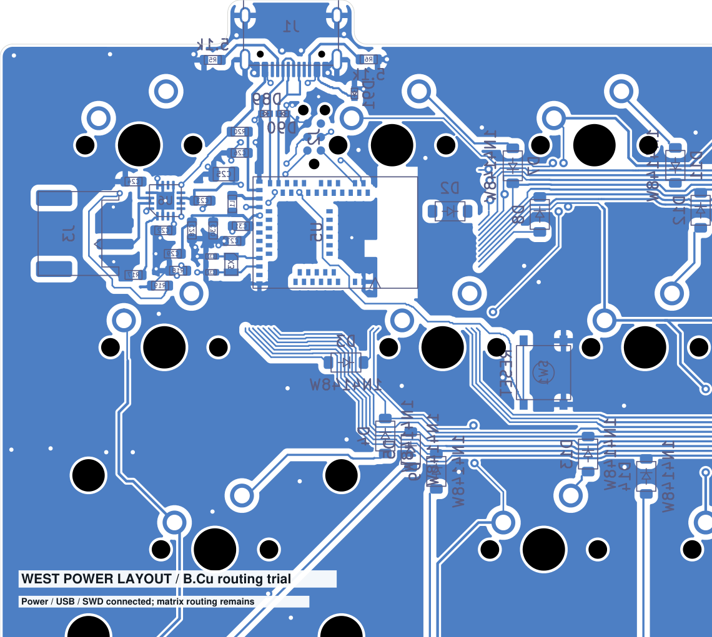

# 無線版PCB：主要配線の現状

2026-11-04。GPIO系以外の電源・水晶・USB・SWD・リセットの未接続を解消した。接続確認の段階であり、製造用の配置配線確定・実機検証ではない。

[PCB](../ts52k.kicad_pcb) / [全体画像](overview.png) / [最新DRC](drc.json)

## 配置・接続

- U5は(28,63) mm、90°。西側に電源回路を集約。
- J3はユーザー配置(4.4196,63.0936) mm、90°を維持。北東のカットアウト付近の旧案は撤回。
- U6は(12,60) mm、0°。VDDの4.7 µF＋1 µF＋100 nF×3、その他の電源容量、水晶負荷容量を接続。
- J2は(26,54) mm、90°へ仮移動。SWDIO・SWCLK・VDD・GND・RESETを接続。リセットスイッチの両端子群も接続。
- 長い電源迂回を撤去し、短いF.Cu交差を利用。SWD電源のF.Cu部分は合計約3.7 mm、SWCLKは約4 mm。RESETの重複配線・ビアを整理。
- ユーザー編集のUSB D+/D-配線を保持。インピーダンス・スキュー・反対面GNDの詳細確認は未完了。
- GND島に接続ビアを追加。R17、C29、U5の55番、C22、J3、C30のGNDパッドを局所的にベタ直接接続とし、サーマル不足を解消。

## 検査と残り

最新DRCは違反129件、未接続26件、回路図との不一致0件。未接続はマトリクス・エンコーダ系のみ。短絡、電気的クリアランス、穴クリアランス、keepout違反、GND未接続、サーマル不足は解消した。

残りはcourtyardの重なり、切断した旧配線の端、シルク・文字。GPIOの南側パッドへのネット変更と配線は未実施。現在の経路はラフで、細かな折れ曲がり・幅・F.Cu交差周辺の帰路・USBペア・アンテナ周辺の最終レビューが必要。

電池・ケース設計は対象外。placement.jsonとprepare_rough.pyは初期仮配置の記録であり、現在位置はPCBを正とする。以前の追記の文字化けを修正し、本文を現在の状態で整理し直した。
